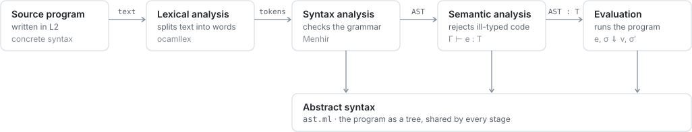

# L2 Language

[](https://github.com/tobiasMarion/l2-language/actions/workflows/ci.yml)

A parser, type inference algorithm and big-step evaluator for **L2**, a small functional language with imperative constructs (references, sequencing and `while` loops), written in OCaml.

Final project for *Programming Languages I* (INF05029) at the Federal University of Rio Grande do Sul (UFRGS), 2026/2.

## Architecture

<picture>
  <source media="(prefers-color-scheme: dark)" srcset="docs/architecture/dark.svg">
  
</picture>

The interpreter follows the classic pipeline:

| Phase | Input → output | Specification |
|-------|----------------|---------------|
| Lexical analysis | source text → tokens | regular expressions (ocamllex) |
| Syntax analysis | tokens → abstract syntax tree | LR grammar (Menhir) |
| Semantic analysis | AST → type `T` | type system, `Γ ⊢ e : T` |
| Evaluation | AST and store → value and store | big-step operational semantics, `e, σ ⇓ v, σ′` |

The **abstract syntax** (`ast`, `tp`, `bop`) is the module every phase shares: the parser builds it, and the type inference and the evaluator traverse it. Its definition, as given by the course, is in [`docs/ast_datatypes.ml`](docs/ast_datatypes.ml). The assignment statement, with L2's syntax, typing rules and semantics, is in [`docs/assignment.pdf`](docs/assignment.pdf).

## Setup

### 1. Install opam, OCaml's package manager

| OS      | Command |
|---------|---------|
| macOS   | `brew install opam` |
| Linux   | `bash -c "sh <(curl -fsSL https://opam.ocaml.org/install.sh)"` |
| Windows | `winget install Git.Git OCaml.opam` in PowerShell, then open a new terminal |

### 2. Initialize opam, once per machine

```sh
opam init
```

Answer **yes** when it asks to update your shell configuration. On Windows, accept the defaults it proposes for the Unix tools it needs.

### 3. Clone the repository and create its local switch

```sh
git clone git@github.com:tobiasMarion/l2-language.git
cd l2-language
opam switch create . 5.5.2 --deps-only --with-dev-setup
```

This creates `_opam/` with the OCaml compiler, dune and the development tools (`ocaml-lsp-server`, `ocamlformat`, `utop`). It takes a few minutes.

### 4. Load the switch in your terminal

Run this whenever you open a terminal in the repository:

| Shell | Command |
|-------|---------|
| bash, zsh | `eval $(opam env)` |
| fish | `eval (opam env)` |
| PowerShell | `(& opam env) -split '\r?\n' \| ForEach-Object { Invoke-Expression $_ }` |

## Usage

From the repository root:

```sh
dune build          # compile
dune exec l2        # run
dune test           # run the tests
dune build --watch  # recompile on every save
dune utop lib       # REPL with the library loaded
dune fmt            # format the code
```

## Editor

Install the [OCaml Platform](https://marketplace.visualstudio.com/items?itemName=ocamllabs.ocaml-platform) extension for VS Code. Open the repository and select the repository's local switch when the extension asks for a sandbox.

## License

[MIT](LICENSE)
